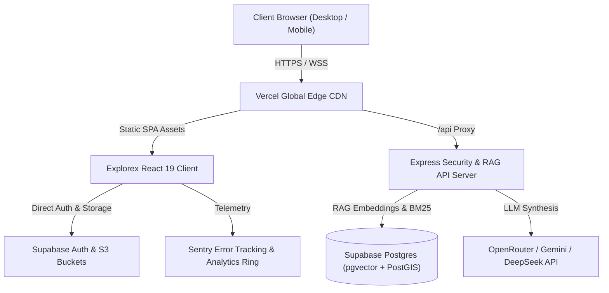

# Explorex Production Deployment & Infrastructure Guide

This guide documents the complete end-to-end deployment procedure for **Explorex** across **Vercel** (Frontend SPA), **Supabase** (Postgres + Auth + Storage), and **Node.js API Server** (Express + RAG Retrieval Pipeline).

---

## 1. Architecture Overview



---

## 2. Environment Variables Reference

Create a production `.env` file (or set environment variables in your Vercel and hosting dashboard):

| Variable | Required | Context | Description |
| :--- | :---: | :---: | :--- |
| `VITE_SUPABASE_URL` | Yes | Frontend | Your Supabase project URL (`https://xyz.supabase.co`) |
| `VITE_SUPABASE_ANON_KEY` | Yes | Frontend | Public anonymous Supabase key (safe for browser) |
| `VITE_API_BASE_URL` | Optional | Frontend | Target backend API URL (defaults to `/api` proxy) |
| `VITE_SENTRY_DSN` | Optional | Frontend | Sentry DSN for client-side crash telemetry |
| `PORT` | Optional | Backend | Node server listen port (default: `5005`) |
| `SUPABASE_SERVICE_ROLE_KEY` | Yes | Backend | Supabase privileged service role key for RAG search |
| `JWT_SECRET` | Yes | Backend | 32+ character random secret for admin session tokens |
| `OPENROUTER_API_KEY` | Optional | Backend | LLM synthesis API key for production chatbot |
| `ORS_API_KEY` | Optional | Backend | OpenRouteService API key for directions & routing |
| `ADMIN_TOTP_SECRET` | Optional | Backend | Base32 secret for Admin Console 2FA authentication |

---

## 3. Database Setup & Supabase Migrations

Explorex stores nationwide destinations, verified image hashes, RAG chunk embeddings, user profiles, itineraries, and feedback in Supabase Postgres.

### Step 3.1: Apply SQL Migrations
Run the migrations in sequential order via the Supabase Dashboard SQL Editor or Supabase CLI:

```bash
# Using Supabase CLI
supabase db push
```

Or execute directly from `/supabase/migrations`:
1. `20261024000000_schema_core.sql`: Core tables (`profiles`, `places`, `place_images`, `saved_places`, `trips`, `trip_days`, `user_feedback`, `audit_logs`).
2. `20261024000001_pgvector_rag.sql`: Vector extensions (`vector`), `place_embeddings` table, and hybrid RRF search functions.
3. `20261024000002_rls_policies.sql`: Row Level Security policies guaranteeing strict data isolation.

### Step 3.2: Storage Buckets Configuration
Create the following public storage buckets in the Supabase Dashboard under **Storage**:
1. `place-images`: Allowed MIME types: `image/jpeg, image/png, image/webp`, max file size: 5MB.
2. `user-avatars`: Allowed MIME types: `image/jpeg, image/png, image/webp`, max file size: 2MB.
3. `feedback-screenshots`: Allowed MIME types: `image/jpeg, image/png, image/webp`, max file size: 5MB.

### Step 3.3: Creating the First Administrator
> [!IMPORTANT]
> To preserve governance integrity, administrators **can never be created via public client sign-up**. First sign up as a regular user, then run the following documented SQL command in your Supabase SQL editor:

```sql
-- Promote an existing user to full administrator
UPDATE public.profiles
SET role = 'admin'
WHERE id = (
  SELECT id FROM auth.users WHERE email = 'admin@yourdomain.in'
);

-- Confirm promotion
SELECT id, email, role, display_name, created_at 
FROM public.profiles 
WHERE role = 'admin';
```

---

## 4. Frontend Deployment on Vercel

Explorex is optimized for zero-config Vercel deployment with included `vercel.json` SPA routing rewrites and security headers.

1. **Import Git Repository**: Connect `https://github.com/manikanta9394/Explorex.git` in Vercel.
2. **Build Configuration**:
   - Framework Preset: `Vite`
   - Build Command: `npm run build`
   - Output Directory: `dist`
   - Install Command: `npm install --legacy-peer-deps`
3. **Set Environment Variables**:
   - Add `VITE_SUPABASE_URL` and `VITE_SUPABASE_ANON_KEY`.
4. **Deploy**: Click **Deploy**. Vercel will build and publish global edge assets.

---

## 5. Backend Server Deployment (Render / Railway / Fly.io)

1. **Docker / Container Deployment**:
   ```dockerfile
   FROM node:20-alpine
   WORKDIR /app
   COPY package*.json ./
   RUN npm ci --omit=dev
   COPY server/ ./server/
   COPY src/data/ ./src/data/
   COPY scripts/ ./scripts/
   EXPOSE 5005
   CMD ["node", "server/index.js"]
   ```
2. **Health Telemetry**:
   Once deployed, verify operational status:
   ```bash
   curl -s https://api.yourdomain.in/api/health
   ```
   Expected response:
   ```json
   {
     "status": "ok",
     "service": "explorex-api",
     "uptime_seconds": 1284,
     "database": { "status": "healthy" }
   }
   ```

---

## 6. Pre-Flight Verification Checklist

Before opening the site to production traffic, verify:
- [x] All 507 nationwide places have verified coordinates strictly inside India (`npm run check:data`).
- [x] All 171 landmark images pass unique SHA-256 hash checks with zero duplicates (`npm run check:images`).
- [x] All unit, integration, and End-to-End user journeys pass cleanly (`npm run test:all`).
- [x] Rate limiting is enabled on `/api/chat` (30 reqs/min) and feedback endpoints (60 reqs/min).
- [x] Production security headers (CSP, HSTS, `X-Content-Type-Options: nosniff`, `X-Frame-Options: DENY`) are active.
