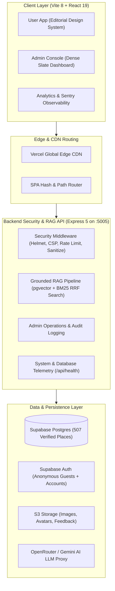

# Explorex – All-India Cultural Travel & Heritage Companion

> **Explore India the way locals do.** Explorex is a production-grade, nationwide heritage explorer, intelligent trip planner, and retrieval-augmented AI travel companion covering all 36 States and Union Territories of India. Built with authentic editorial aesthetics, trustworthy open-source data (Wikidata, Wikipedia, ASI), strict image integrity (SHA-256 zero-duplication guarantees), dual-app architecture (warm editorial user app vs dense slate admin app), and enterprise-grade security.

---

## 🏗️ Architecture Overview



---

## 🇮🇳 Nationwide Expansion & Data Integrity

Explorex covers all **36 Indian States & Union Territories** with 507 verified destinations:

1. **Authentic Data Foundation (`scripts/checkDataIntegrity.js`)**:
   - Every destination links to an authentic Wikidata entity (`wikidata_id`) as the source of truth for coordinates, names, and licensing.
   - **No Fabricated Facts**: Unverified ratings or hours are never manufactured. Pricing reflects official Archaeological Survey of India (ASI) or state tourism rates in Indian Rupees (₹) with Indian number formatting (`₹1,50,000`).
   - **Boundary Enforcement**: Every destination's latitude and longitude are strictly verified to reside within India (`6.0°–37.5° N`, `68.0°–97.5° E`) and inside its stated state boundary box.
2. **Absolute Image Integrity (`npm run check:images`)**:
   - 171 verified unique destination photographs.
   - Every image hash (SHA-256) is unique: a photo of Charminar can never appear on Taj Mahal or any other destination.
   - Verified metadata includes author attribution, Creative Commons license (e.g. CC BY-SA 4.0), and source link. Deterministic vector illustrations (`🎨 Illustration`) provide clean fallbacks when no verified photograph is available.
3. **Dual-App User Experience**:
   - **User App**: Warm, editorial, image-led (cream, forest green, gold, Playfair Display + Inter, large photography, playful motion).
   - **Admin Console (`/admin`)**: Dense, functional slate design (`slate-dark` / `slate-light`), compact data tables, keyboard shortcuts (⌘K Command Palette), and zero marketing animations.

---

## 🏛️ Key Features

- **Curated Heritage Directory (`/explore`, `/explore/:id`)**:
  - 507 verified attractions, Nizami royal monuments, heritage stays, and authentic culinary dining spots.
  - Live weather badge (temperature in °C and conditions via cached Open-Meteo API).
  - Recommended seasonal guidance ("Best Time to Visit").
  - Hourly crowd level mini bar chart with real-time "Now" indicator.
  - Turn-by-turn navigation via Google Maps with walking, cycling, and driving modes.
  - Wishlist bookmarking (works seamlessly for guests and syncs to account upon sign-in).

- **Clustered Spatial Explorer (`/map`)**:
  - Clustered interactive Leaflet map using custom color-coded category pins.
  - Strict geographic validation restricting and logging any pins outside India.
  - "My Location" GPS geolocation with custom pulsing beacon.
  - Spatial place preview popup with distance, transit time, and direction actions.

- **Multimodal Trip Planner (`/planner`)**:
  - 1- to 4-day customizable itineraries clustered by proximity (nearest-neighbour algorithm).
  - Midpoint lunch recommendations near each day's cluster.
  - Interactive budget slider with dynamic warning when exceeding budget.
  - "Trim stops to fit budget" automatic budget optimization toggle.
  - **Shareable Trip Link**: Encodes parameters in URL for instant sharing and loading.
  - **Group Expense Splitter**: Equal & custom split calculation, debt settlement algorithm ("Who owes whom"), and WhatsApp-ready settlement clipboard copy.

- **Explorex AI Assistant (`/ai`)**:
  - Grounded RAG travel companion powered by backend pgvector hybrid search (vector similarity + BM25 reciprocal rank fusion).
  - Cites only dataset chunks using inline references (`[1]`, `[2]`) and renders clickable place recommendation cards.
  - Multilingual support: English, Telugu (`తెలుగు`), Hindi (`हिन्दी`), Tamil (`தமிழ்`).
  - Voice speech input (Web Speech API).

- **Citizen Curation & Feedback Panel (`/feedback`)**:
  - Floating drawer on every page and full feedback studio.
  - 5-star ratings, category tagging (content error, bug, feature idea, praise), destination linking, and screenshot upload.
  - "My feedback" history tab displaying real-time curator replies.

- **All-India Emergency & Helpline Directory**:
  - 24x7 verified helpline numbers (Police 100, Ambulance 108, Tourist Helpline 1363, National Emergency 112, Women Helpline 1091).
  - Nearest multispecialty trauma care hospitals with direct directions.
  - Live GPS coordinate beacon with one-click copy.

---

## 🛠️ Technology Stack

| Layer | Technologies |
| :--- | :--- |
| **Frontend** | React 19, Vite 8, Tailwind CSS v4, Leaflet & `leaflet.markercluster`, Lucide React |
| **Backend API** | Node.js, Express 5, Helmet (Custom CSP), CORS, Rate Limiter, Input Sanitizer |
| **Database** | Supabase Postgres, `pgvector` (HNSW indexes), PostGIS, Row Level Security (RLS) |
| **Auth** | Supabase Auth (Anonymous Guest sessions + Email/Password + Google OAuth) |
| **Testing** | Node Test Runner, Playwright (Chromium E2E), Vitest |
| **Observability** | Sentry Error Tracking, Product Analytics Event Stream, `/api/health` Telemetry |
| **CI / CD** | GitHub Actions (`ci.yml`), Vercel Global Edge Hosting (`vercel.json`) |

---

## 🚀 Getting Started

### 1. Prerequisites
- **Node.js**: v20.18.0+ or v22+
- **npm**: v10+

### 2. Installation
Clone the repository and install dependencies:

```bash
git clone https://github.com/manikanta9394/Explorex.git
cd Explorex
npm install --legacy-peer-deps
```

### 3. Environment Configuration
Copy `.env.example` to `.env`:

```bash
cp .env.example .env
```

Set your configuration values:

```env
# Frontend Supabase Keys
VITE_SUPABASE_URL=https://your-project.supabase.co
VITE_SUPABASE_ANON_KEY=your_supabase_anon_key

# Backend Server
PORT=5005
JWT_SECRET=your_jwt_secret_change_in_production
OPENROUTER_API_KEY=your_openrouter_api_key_optional
ORS_API_KEY=your_openrouteservice_key_optional
```

*(Note: Explorex includes resilient offline emulators for all services, so you can explore all features even without third-party API keys).*

---

## 💻 Running the Application

### Start the Backend Proxy Server:
```bash
npm run server
```
The server will start at `http://localhost:5005` (Health telemetry at `http://localhost:5005/api/health`).

### Start the Frontend Dev Server:
```bash
npm run dev
```
Open your browser at `http://localhost:5180/Explorex/`.

### Run Production Build:
```bash
npm run build
```

---

## 🧪 Comprehensive Quality & Test Suite

Run the full testing matrix with a single command:

```bash
# Run all unit, integration, integrity, and E2E tests
npm run test:all
```

### Individual Test Commands:
```bash
# 1. Unit & Data Layer Integration Tests (19 tests)
npm test

# 2. Automated Playwright End-to-End Tests (9 core user journeys)
npm run test:e2e

# 3. Comprehensive Data & Coordinate Boundary Verification (2,706 checks)
npm run check:data

# 4. Image Hash Integrity & Anti-Duplication Audit (171 landmarks)
npm run check:images

# 5. Linting (oxlint)
npm run lint
```

---

## 🛡️ Admin Operations & First Admin Setup

Explorex isolates the `/admin` dashboard completely from public views.

### First Admin Creation (Documented SQL - Never via UI):
To designate an administrator, execute this SQL command in your Supabase SQL Editor:

```sql
UPDATE public.profiles
SET role = 'admin', totp_enabled = TRUE
WHERE email = 'admin@explorex.in';
```

### Admin Features:
- **⌘K Command Palette**: Fast keyboard navigation across all 9 modules.
- **Two-Factor Authentication (TOTP)**: Supported at `/admin/login`.
- **Places Management**: Full CRUD with coordinate validation and ASI source linking.
- **Image Review Queue**: Deduplication enforcement blocking matching SHA-256 hashes.
- **Feedback Inbox**: Master-detail triage with SLA breach alerts and direct reply dispatcher.
- **AI Quality Studio**: Audit negative feedback, review RAG retrieved chunks, and inspect golden evals.
- **Content Studio**: National festival calendar editor, announcement banners, and FAQs.
- **Immutable Audit Trail**: Chronological before/after diffs for all administrative writes.

---

## 🔒 Security & Observability

- **Rate Limiting**: Sliding window rate limiter enforcing 30 requests/minute on AI chat and 60 requests/minute on general endpoints.
- **Input Sanitization**: Automatically strips `<script>`, `<iframe>`, and malicious HTML event handlers from chat and feedback inputs.
- **Security Headers**: Helmet configured with strict Content Security Policy (CSP), `X-Frame-Options: DENY`, and `X-Content-Type-Options: nosniff`.
- **Telemetry & Health**: Live monitoring at `/api/health` providing memory footprint, uptime, and database status. Sentry client-side error tracking and local analytics event ring buffer.
